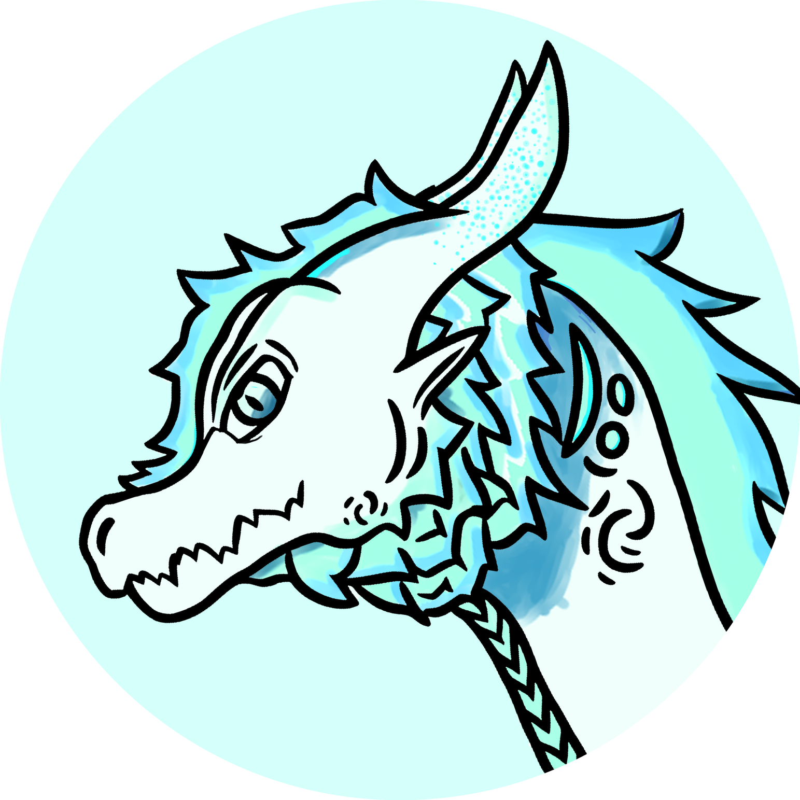

<h1 align="center">我是 EyroIceDragon</h1>

I'm EyroIceDragon

<h3 align="center">一只冰蓝色的小龙，正在学习编程与美术</h3>

A little ice-blue dragon, learning programming and art

  

  

Personal Website · Click to visit

---

### 关于这只龙

About this dragon

- **2024 年** 接触了 **GML**，从此掉进了编程的坑
   In 2024, I touched GML and fell into the programming pit ever since.
- **2025 年** 开始啃 **Java**，目前还在被 Java 按在地上摩擦
   In 2025, I started grinding Java, and I'm still being rubbed into the ground by it.
- **2024 年** 拥有了自己的 GitHub 小窝，开始囤代码
   In 2024, I got my own little GitHub nest and started hoarding code.
- 美术不太懂，画出来的龙可能像一只胖蜥蜴
   Not great at art — my dragons might look like chubby lizards.
- 但是！**我热爱编程**！虽然很菜，但我会一直开发下去的！
   But! I love programming! I may be a noob, but I'll keep developing!
- 一只**永不放弃**的小龙，菜但坚持，菜但快乐
   A little dragon that never gives up — noob but persistent, noob but happy.

---

### 技能面板

Skill Panel

  
  
  

> 技能树状态：
>  Skill tree status:
> - GML ██████░░░░ 咕噜咕噜
>    GML — gurgle gurgle
> - Java  ██░░░░░░░░ 嗷……好难
>    Java — ow... so hard
> - 美术  ░░░░░░░░░░ 完全不点
>    Art — not leveled at all
> - 坚持 ██████████ 满级！
>    Persistence — max level!

---

### 小龙的 GitHub 窝

The little dragon's GitHub nest

  
  

  

---

### 小龙的奖杯

The little dragon's trophies

  

---

### 龙之箴言

Dragon's motto

  <i>"明天学Gml 与 JAVA 嗷呜~"</i>

"Tomorrow I'll learn GML and JAVA, awoo~"

  <i>"今天学不会 Java，明天继续 嗷！"</i>

"If I can't learn Java today, I'll keep going tomorrow, awoo!"

---

### 来找小龙玩

Come play with the little dragon

  
  
  

Personal Website · GitHub · Email

  
  

  
  

---

  

